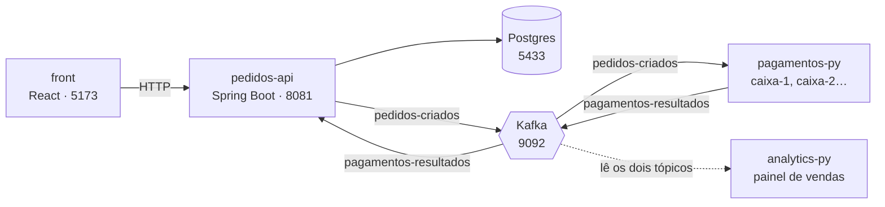

# ☕ Loja Café


Uma loja de café completa e pequena, de ponta a ponta, para estudar **mensageria com Kafka**.
O cliente faz o pedido no navegador, a API grava no Postgres e anota o fato no Kafka, o serviço de
Pagamentos decide em segundos e o status muda sozinho na tela, sem recarregar a página.


## O que o projeto mostra

- **Comunicação assíncrona:** a API responde ao cliente em milissegundos (`AGUARDANDO_PAGAMENTO`); o pagamento acontece depois, por eventos.
- **Desacoplamento:** o Pagamentos pode ficar fora do ar. Os pedidos esperam no Kafka e são processados quando ele volta.
- **Escala horizontal:** dois ou mais caixas dividem o trabalho pelo mesmo grupo de consumidores, e o Kafka rebalanceia se um cair.
- **Quem chega depois lê tudo:** o Analytics nasce depois dos pedidos e reconstrói o painel lendo o histórico do tópico.
- **Idempotência:** o mesmo resultado entregue duas vezes não altera o pedido de novo.
- **Preço no servidor:** o cliente nunca informa preço; a API calcula pelo cardápio dela.

## Arquitetura



1. O front chama `POST /pedidos`. A API valida, calcula o valor, grava no Postgres e publica `pedidos-criados`.
2. Um caixa do Pagamentos lê o evento, espera 3 s (o "banco") e decide: **aprovado até R$ 100,00**, acima disso recusa.
3. O resultado vai para `pagamentos-resultados`; a API lê e atualiza o pedido para `PAGO` ou `RECUSADO`.
4. O front consulta `GET /pedidos` a cada 2 s e mostra o status mudando.

## Stack

| Peça | Tecnologia | Porta |
|---|---|---|
| `front/` | React 19, Vite, JavaScript puro (sem bibliotecas de UI) | 5173 |
| `pedidos-api/` | Spring Boot 4, Java 21, Spring Data JPA, Bean Validation | 8081 |
| `pagamentos-py/` | Python 3, Flask, `confluent-kafka` | 5001 (5002 para a 2ª instância) |
| `analytics-py/` | Script Python, `confluent-kafka` | — |
| `infra/` | Docker Compose: Postgres 16, Kafka 3.9 (KRaft), kafka-ui | 5433 · 9092 · 8090 |
| `specs/` | Contratos da API, dos eventos e do Pagamentos; coleção do Insomnia | — |

## Começando

**Pré-requisitos:** Docker, JDK 21 (`JAVA_HOME` apontando para ele), Node 20+ e Python 3.

```bash
# 1. Infra: Postgres + Kafka + painel
cd infra && docker compose up -d --wait

# 2. API (outro terminal)
cd pedidos-api && ./mvnw spring-boot:run          # Windows: mvnw.cmd spring-boot:run

# 3. Pagamentos (outro terminal)
cd pagamentos-py
python -m venv .venv && source .venv/bin/activate  # Windows: .venv\Scripts\activate
pip install -r requirements.txt && python app.py

# 4. Front (outro terminal)
cd front && npm install && npm run dev
```

Abra **http://localhost:5173**, faça um pedido e veja o status mudar de amarelo para verde.
Para ver uma recusa, peça mais de R$ 100,00 (por exemplo, 20 bolos).

Passo a passo completo, segundo caixa e Analytics: [COMO-RODAR.md](COMO-RODAR.md).

## Endpoints

Contrato completo em [`specs/api.md`](specs/api.md).

| Método | Rota | O que faz |
|---|---|---|
| `GET` | `/produtos` | Cardápio (id, nome, descrição, emoji, preço) |
| `GET` | `/opcoes` | Tamanhos e extras aceitos |
| `POST` | `/pedidos` | Cria um pedido. `201` com o pedido ou `400` dizendo qual campo falhou |
| `GET` | `/pedidos?limite=N` | Pedidos do mais novo ao mais antigo (padrão 100, máximo 200) |

```http
POST http://localhost:8081/pedidos
Content-Type: application/json

{ "cliente": "Ana", "produtoId": 2, "quantidade": 2, "tamanho": "GRANDE",
  "extras": ["CHANTILLY", "CANELA"], "observacao": "sem açúcar" }
```

`valor = quantidade × (preço do produto + ajuste do tamanho + extras)`. No exemplo: 2 × (12,00 + 3,00 + 2,00 + 0,50) = **R$ 35,00**.

## Eventos (Kafka)

Contrato em [`specs/eventos.md`](specs/eventos.md): JSON em texto, chave = `pedidoId`, 3 partições por tópico.

| Tópico | Quem publica | Quem lê (grupo) |
|---|---|---|
| `pedidos-criados` | `pedidos-api` | `pagamentos-py` (`pagamentos`), `analytics-py` (`analytics`) |
| `pagamentos-resultados` | `pagamentos-py` | `pedidos-api` (`pedidos-api`), `analytics-py` (`analytics`) |

## Banco de dados e ferramentas

| | |
|---|---|
| Postgres | `localhost:5433` · banco `loja_cafe` · usuário `loja` · senha `loja` |
| **DBeaver** | nova conexão PostgreSQL com os dados acima; o usuário pode criar outros bancos |
| **Insomnia** | *Import* de [`specs/loja-cafe.postman_collection.json`](specs/loja-cafe.postman_collection.json) |
| Painel do Kafka | http://localhost:8090 (tópicos, mensagens e lag dos grupos) |

## Testes

```bash
cd pedidos-api   && ./mvnw test                 # 19 testes: regras, validação e HTTP (H2 em memória, sem Docker)
cd pagamentos-py && python -m unittest -v       # 5 testes: regra de negócio e evento inválido
cd front         && npm run lint                # oxlint
```

## Estrutura

```
loja-cafe/
├── front/            React + Vite (api.js, App.jsx, index.css)
├── pedidos-api/      Spring Boot (controllers, entidades, repositórios, eventos Kafka)
├── pagamentos-py/    Flask + consumidor Kafka em thread própria
├── analytics-py/     Painel de vendas lido do Kafka
├── infra/            compose.yml (Postgres, Kafka, kafka-ui)
├── specs/            Contratos e coleção do Insomnia
├── docs/             Imagens do README
├── AGENTS.md         Regras do projeto (para pessoas e agentes de IA)
└── COMO-RODAR.md     Como subir cada peça
```

## Histórico por atos

O projeto foi construído em atos; cada branch guarda um marco:

| Branch | Ato |
|---|---|
| `ato-2` | Pagamento por HTTP, **síncrono**: a API espera o Pagamentos responder (3 s) |
| `ato-3` | Kafka no meio: a API responde na hora e o Pagamentos lê do tópico |
| `ato-4` | Analytics: quem chega depois lê o histórico inteiro |
| `ato-5` | Dois caixas dividindo as partições |
| `main` | Tudo acima, mais as melhorias (Postgres, cardápio no servidor, front novo) |

## Limitações (projeto didático)

Não há login, estoque, frete nem pagamento real; cada pedido tem um único item.
O Kafka e o Postgres rodam sem autenticação e só aceitam conexões locais (`127.0.0.1`).
O Pagamentos usa o servidor de desenvolvimento do Flask. Para produção, veja os pontos de auditoria no histórico do projeto.

## Cuidados

- **Nunca** rode `docker compose down -v`: apaga os eventos do Kafka e os pedidos do Postgres. Para parar, use `docker compose stop`.
- A porta 8080 não é usada de propósito (costuma estar ocupada). A API roda na **8081**.
