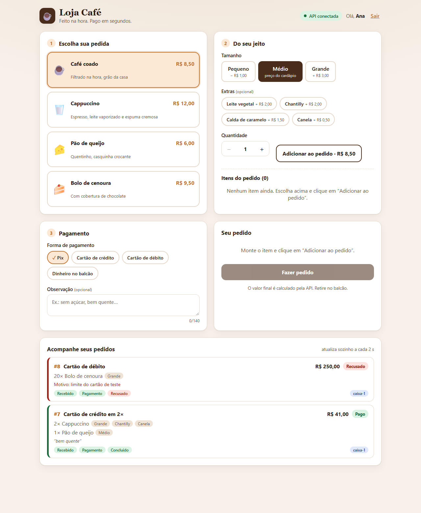
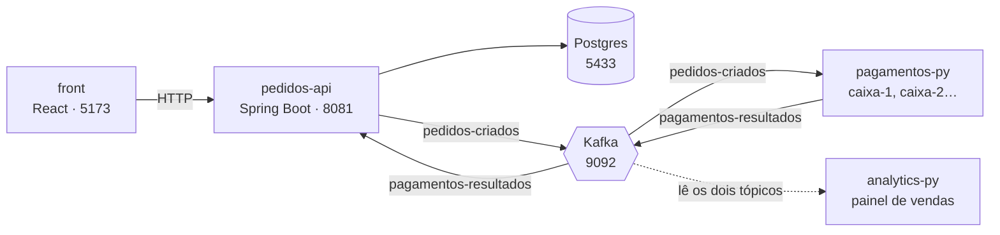

# ☕ Loja Café


Uma loja de café completa e pequena, de ponta a ponta, para estudar **mensageria com Kafka**.
O cliente faz o pedido no navegador, a API grava no Postgres e anota o fato no Kafka, o serviço de
Pagamentos decide em segundos e o status muda sozinho na tela, sem recarregar a página.



## O que o projeto mostra

- **Comunicação assíncrona:** a API responde ao cliente em milissegundos (`AGUARDANDO_PAGAMENTO`); o pagamento acontece depois, por eventos.
- **Desacoplamento:** o Pagamentos pode ficar fora do ar. Os pedidos esperam no Kafka e são processados quando ele volta.
- **Escala horizontal:** dois ou mais caixas dividem o trabalho pelo mesmo grupo de consumidores, e o Kafka rebalanceia se um cair.
- **Quem chega depois lê tudo:** o Analytics nasce depois dos pedidos e reconstrói o painel lendo o histórico do tópico.
- **Idempotência:** o mesmo resultado entregue duas vezes não altera o pedido de novo.
- **Preço no servidor:** o cliente nunca informa preço; a API calcula pelo cardápio dela.

## Arquitetura



1. O front chama `POST /pedidos`. A API valida, calcula o valor, grava no Postgres e publica `pedidos-criados`.
2. Um caixa do Pagamentos lê o evento, espera 3 s (o "banco") e decide: **aprovado até R$ 100,00**, acima disso recusa.
3. O resultado vai para `pagamentos-resultados`; a API lê e atualiza o pedido para `PAGO` ou `RECUSADO`.
4. O front consulta `GET /pedidos` a cada 2 s e mostra o status mudando.

## Stack

| Peça | Tecnologia | Porta |
|---|---|---|
| `front/` | React 19, Vite, JavaScript puro (sem bibliotecas de UI) | 5173 |
| `pedidos-api/` | Spring Boot 4, Java 21, Spring Data JPA, Bean Validation | 8081 |
| `pagamentos-py/` | Python 3, Flask, `confluent-kafka` | 5001 (5002 para a 2ª instância) |
| `analytics-py/` | Script Python, `confluent-kafka` | — |
| `infra/` | Docker Compose: Postgres 16, Kafka 3.9 (KRaft), kafka-ui | 5433 · 9092 · 8090 |
| `specs/` | Contratos da API, dos eventos e do Pagamentos; coleção do Insomnia | — |

## Começando

**Pré-requisitos:** Docker, JDK 21 (`JAVA_HOME` apontando para ele), Node 20+ e Python 3.

```bash
# 1. Infra: Postgres + Kafka + painel (as senhas ficam em infra/.env, fora do Git)
cp infra/.env.example infra/.env   # depois TROQUE as senhas dentro dele
cd infra && docker compose up -d --wait

# 2. API (outro terminal)
cd pedidos-api && ./mvnw spring-boot:run          # Windows: mvnw.cmd spring-boot:run

# 3. Pagamentos (outro terminal)
cd pagamentos-py
python -m venv .venv && source .venv/bin/activate  # Windows: .venv\Scripts\activate
pip install -r requirements.txt && python app.py

# 4. Front (outro terminal)
cd front && npm install && npm run dev
```

Não há cadastro público: a API cria o primeiro **ADMIN** com `ADMIN_EMAIL`/`ADMIN_PASSWORD` do `infra/.env`. Crie uma conta de atendente (a loja 1 é a "Matriz"):

```bash
scripts/criar-usuario.sh bia@loja.com Bia ATENDENTE 1     # pede a senha no terminal
```

Abra **http://localhost:5173**, entre como atendente, monte o pedido e veja o status mudar de amarelo para verde.
Para ver uma recusa, pague no **crédito ou débito** um pedido acima de R$ 100,00 (por exemplo, 20 bolos). No Pix e no dinheiro não há limite.

Passo a passo completo, segundo caixa e Analytics: [COMO-RODAR.md](COMO-RODAR.md).

## Endpoints

Contrato completo em [`specs/api.md`](specs/api.md).

| Método | Rota | O que faz |
|---|---|---|
| `GET` | `/produtos` | Cardápio (id, nome, descrição, emoji, preço, estoque) |
| `GET` | `/opcoes` | Tamanhos, extras e formas de pagamento aceitos |
| `POST` | `/auth/entrar` | Login: devolve o token, o papel e a loja (`401` se e-mail ou senha estão errados, `429` após 5 erros) |
| `POST` | `/auth/sair` 🔒 | Encerra a sessão |
| `GET` | `/produtos` 🔒 | Cardápio da rede (só itens ativos) com o **estoque da sua loja** |
| `GET` `POST` | `/cardapio` 🔒 admin | Lista todos os produtos (inclusive desativados) e cria produto novo (nasce com estoque 0 nas lojas) |
| `PUT` | `/cardapio/{id}` 🔒 admin | Altera nome, descrição, emoji, preço e liga/desliga o item; preço novo vale só para pedidos novos |
| `GET` `POST` | `/insumos` 🔒 admin, gerente | Catálogo de insumos com o estoque da loja; o ADMIN cadastra (nome, unidade `G`/`ML`/`UN`) |
| `PUT` | `/insumos/{id}` 🔒 admin | Renomeia e liga/desliga o insumo (a unidade não muda) |
| `PUT` | `/lojas/{id}/insumos/{insumoId}` 🔒 admin, gerente | Contagem do estoque do insumo e mínimo do alerta (o gerente, só na própria loja) |
| `GET` | `/insumos/alertas` 🔒 admin, gerente | O que está abaixo do mínimo; os que acabaram primeiro |
| `GET` `PUT` | `/fichas/produtos/{id}` · `/fichas/extras/{codigo}` 🔒 | Ficha técnica (quanto de cada insumo gasta 1 unidade, tamanho Médio); só o admin grava |
| `POST` | `/pedidos` 🔒 atendente, gerente | Lança um pedido com 1 a 10 itens. `201`, ou `400` dizendo qual campo falhou ou qual produto está sem estoque |
| `GET` | `/pedidos?limite=N` 🔒 | Os pedidos **da sua loja**, do mais novo ao mais antigo (padrão 100, máximo 200). O ADMIN vê todas |
| `GET` `POST` | `/usuarios` 🔒 admin, gerente | Lista e cria contas da equipe (o gerente só cria atendente e cozinha, na própria loja) |
| `PUT` | `/usuarios/{id}/ativo` 🔒 admin, gerente | Ativa ou desativa uma conta (desativar derruba as sessões) |
| `GET` `POST` | `/lojas` 🔒 admin | Lista e cria lojas (com estoque inicial opcional) |
| `PUT` | `/lojas/{id}/estoque/{produtoId}` 🔒 admin, gerente | Define o estoque de um produto na loja |
| `GET` | `/auditoria` 🔒 admin, gerente | Quem fez o quê e quando |
| `GET` | `/cozinha` 🔒 | A fila da loja: pedidos pagos ainda não retirados, do mais antigo ao mais novo |
| `PUT` | `/pedidos/{id}/preparo` 🔒 cozinha, atendente, gerente | Avança o pedido: `PREPARANDO` → `PRONTO` (cozinha) → `RETIRADO` (balcão) |
| `PUT` | `/pedidos/{id}/cancelar` 🔒 gerente | Cancela até ficar `PRONTO` (e antes de entrar num fechamento de caixa) e devolve o estoque |
| `GET` | `/relatorios/vendas?data=` 🔒 admin, gerente | Vendas do dia: total, ticket médio, por forma de pagamento, mais vendidos, recusados e cancelados |
| `GET` | `/caixa/resumo` 🔒 admin, gerente | O turno aberto: o que foi vendido desde o último fechamento |
| `POST` | `/caixa/fechamentos` 🔒 gerente | Fecha o turno com o dinheiro contado e registra a diferença |
| `GET` | `/caixa/fechamentos` 🔒 admin, gerente | Histórico de fechamentos |

🔒 = exige `Authorization: Bearer <token>` (sem ele, `401`; papel sem permissão ou outra loja, `403`).

| Papel | Pode |
|---|---|
| `ADMIN` | A rede toda: lojas, usuários, estoque, cardápio e preços, pedidos e auditoria de todas as lojas |
| `GERENTE` | Na sua loja: tudo do balcão e da cozinha, criar/desativar atendente e cozinha, ajustar estoque, cancelar pedidos, fechar o caixa, ver vendas e auditoria |
| `ATENDENTE` | Na sua loja: lançar pedidos, ver os pedidos e marcar como retirado |
| `COZINHA` | Na sua loja: ver os pedidos e tocar a fila de preparo |

```http
POST http://localhost:8081/pedidos
Content-Type: application/json

Authorization: Bearer <token>

{ "cliente": "Ana", "formaPagamento": "CREDITO", "parcelas": 2, "observacao": "sem açúcar",
  "itens": [ { "produtoId": 2, "quantidade": 2, "tamanho": "GRANDE", "extras": ["CHANTILLY", "CANELA"] } ] }
```

`valor do item = quantidade × (preço do produto + ajuste do tamanho + extras)`; `valor do pedido = soma dos itens`.
No exemplo: 2 × (12,00 + 3,00 + 2,00 + 0,50) = **R$ 35,00**. A loja é física: retirada no balcão, sem frete.

**Formas de pagamento** (o Pagamentos simula cada uma): `PIX` aprova em ~1 s sem limite; `CREDITO` (até 3 parcelas) e `DEBITO` levam ~3 s e recusam acima de R$ 100,00; `DINHEIRO` aprova na hora (paga no balcão).
**Estoque:** cada item baixa o estoque **da loja de quem lança**; sem estoque, `400`. Pedido recusado devolve o estoque, uma única vez. O cardápio e os preços são da rede; o estoque é de cada loja.

## Eventos (Kafka)

Contrato em [`specs/eventos.md`](specs/eventos.md): JSON em texto, chave = `pedidoId`, 3 partições por tópico.

| Tópico | Quem publica | Quem lê (grupo) |
|---|---|---|
| `pedidos-criados` | `pedidos-api` | `pagamentos-py` (`pagamentos`), `analytics-py` (`analytics`) |
| `pagamentos-resultados` | `pagamentos-py` | `pedidos-api` (`pedidos-api`), `analytics-py` (`analytics`) |

## Banco de dados e ferramentas

| | |
|---|---|
| Postgres | `localhost:5433` · banco `loja_cafe` · usuário e senha em `infra/.env` (`POSTGRES_USER` / `POSTGRES_PASSWORD`) |
| **DBeaver** | nova conexão PostgreSQL com os dados acima; o usuário pode criar outros bancos |
| **Insomnia** | *Import* de [`specs/loja-cafe.postman_collection.json`](specs/loja-cafe.postman_collection.json) |
| Painel do Kafka | http://localhost:8090 (tópicos, mensagens e lag dos grupos) |

## Testes

```bash
cd pedidos-api   && ./mvnw test                 # 31 testes: regras, validação, login, estoque e HTTP (H2 em memória, sem Docker)
cd pagamentos-py && python -m unittest -v       # 9 testes: regras, formas de pagamento e evento inválido
cd front         && npm run lint                # oxlint
```

## Estrutura

```
loja-cafe/
├── front/            React + Vite (api.js, App.jsx, index.css)
├── pedidos-api/      Spring Boot (controllers, entidades, repositórios, eventos Kafka)
├── pagamentos-py/    Flask + consumidor Kafka em thread própria
├── analytics-py/     Painel de vendas lido do Kafka
├── infra/            compose.yml (Postgres, Kafka, kafka-ui)
├── specs/            Contratos e coleção do Insomnia
├── docs/             Imagens do README
├── AGENTS.md         Regras do projeto (para pessoas e agentes de IA)
└── COMO-RODAR.md     Como subir cada peça
```

## Histórico por atos

O projeto foi construído em atos; cada branch guarda um marco:

| Branch | Ato |
|---|---|
| `ato-2` | Pagamento por HTTP, **síncrono**: a API espera o Pagamentos responder (3 s) |
| `ato-3` | Kafka no meio: a API responde na hora e o Pagamentos lê do tópico |
| `ato-4` | Analytics: quem chega depois lê o histórico inteiro |
| `ato-5` | Dois caixas dividindo as partições |
| `main` | Tudo acima, mais as melhorias (Postgres, cardápio no servidor, front novo) |

## Limitações

Não há pagamento real (o Pagamentos só simula) nem entrega: a loja é física, com retirada no balcão. O login é por e-mail e senha (BCrypt, token de 24 h no banco, limite de tentativas), sem recuperação de senha por e-mail e sem autenticação em dois fatores.
O Postgres e o Kafka exigem senha (`infra/.env`) e só aceitam conexões locais (`127.0.0.1`); o painel do Kafka não tem login próprio. O Kafka usa SASL/PLAIN sem TLS, adequado a rede local ou privada, não à internet.
Ainda não existem a hospedagem, a nota fiscal nem o pagamento real: veja o plano em fases abaixo.

## Rumo à produção (em fases)

| Fase | O que entrega | Situação |
|---|---|---|
| 1. Base profissional | Migrações com Flyway, segredos em `infra/.env`, Postgres e Kafka com senha, login com limite de tentativas, CI e teste de ponta a ponta | feita |
| 2. Rede de lojas | Lojas, papéis (`ADMIN`, `GERENTE`, `ATENDENTE`, `COZINHA`), estoque por loja, auditoria | feita |
| 3a. Cozinha | Fila de preparo, retirada e cancelamento de pedidos | feita |
| 3b. Painel do gerente | Vendas do dia, fechamento de caixa por turno, equipe e estoque (aba "Gerência") | feita |
| 3c-1. Cardápio editável | O ADMIN cria produtos, reajusta preços e liga/desliga itens (aba "Cardápio da rede") | feita |
| 3c-2. Insumos | Ficha técnica, estoque de insumos por loja, baixa automática na venda (sem bloquear), devolução na recusa e alertas | feita |
| 4. Hospedagem | Docker, HTTPS, backup, monitoramento | próxima |
| 5. Pix real | Provedor de pagamento, webhook assinado | pendente |
| 6. Nota fiscal | Emissor fiscal (confirmar com o contador) | pendente |

## Cuidados

- **Nunca** rode `docker compose down -v`: apaga os eventos do Kafka e os pedidos do Postgres. Para parar, use `docker compose stop`.
- A porta 8080 não é usada de propósito (costuma estar ocupada). A API roda na **8081**.
